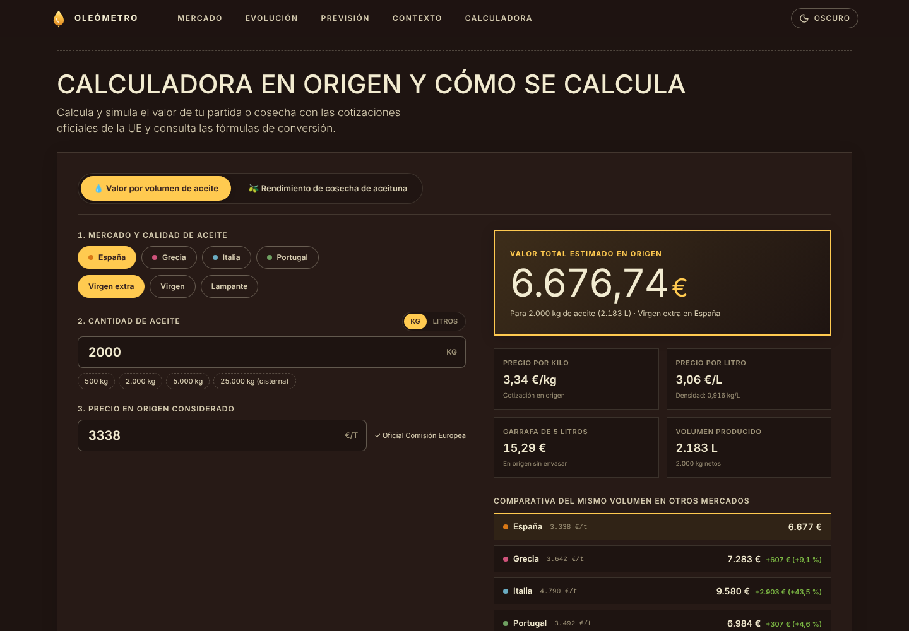

<div align="center">

# 🫒 Oleómetro

**Dashboard de datos abiertos del precio del aceite de oliva en origen**
España · Italia · Grecia · Portugal

### [▶ Ver la web en vivo](https://javicastro03.github.io/Oleometro/)


</div>


Oleómetro reúne las cotizaciones oficiales de la Comisión Europea en un único panel: precio actual, evolución histórica, **previsión estadística con backtest** y una **calculadora de liquidación** para saber cuánto vale una partida de aceite o una cosecha de aceituna.

Backend en **Python (FastAPI)** y frontend en **React (Vite)**, ambos con arquitectura **MVC**. Se despliega **a coste 0** en GitHub Pages y se **actualiza solo cada lunes** con GitHub Actions.

> **Datos:** proceden del [Agri-food Data Portal](https://agridata.ec.europa.eu/extensions/DataPortal/olive-oil.html) de la Comisión Europea (API pública). Son medias semanales en origen y se publican con cierto retraso. Si la fuente no respondiera, la web usa datos de demostración y lo avisa en un aviso visible.

---

## Capturas

| Calculadora en origen | Previsión con backtest |
|---|---|
|  |  |

| Modo claro | Móvil |
|---|---|
|  |  |

---

## Qué incluye

- **Portada**: gota de aceite gigante en SVG con constelación de partículas (triángulos orbitando y anillos concéntricos) en canvas, título animado y tarjeta con el precio vigente del virgen extra en España.
- **Cotizaciones en origen**: precio medio semanal por país y calidad (**virgen extra**, **virgen** y **lampante**), con variación semanal, a 4 semanas, anual y frente al máximo histórico, posición dentro del rango y micrográficos (*sparklines*).
- **Evolución histórica**: gráfico interactivo con horizontes de 3 meses, 6 meses, 1, 3 y 5 años, y comparación entre países.
- **Previsión estadística** a 1 semana, 1 mes y 1 año: tendencia amortiguada (Holt sobre precios en logaritmos) ajustada con factores estacionales, banda de confianza del **80 %** y **backtest** que muestra cuánto se habría equivocado el modelo con datos pasados.
- **Contexto**: producción anual apilada por país y mapa de calor estacional año × mes.
- **Calculadora en origen** con dos modos:
  - *Valor por volumen*: kilos o litros, atajos (500 kg, 2.000 kg, 5.000 kg, cisterna de 25.000 kg), precio editable para simular escenarios, precio por kilo y por litro, garrafa de 5 L y volumen producido.
  - *Rendimiento de cosecha*: de los kilos de aceituna y el rendimiento graso (14 %–28 %) estima el aceite obtenido y su liquidación.
  - Conversión con la densidad estándar **0,916 kg/L** y **comparativa de la misma partida en los otros tres mercados**.
- **Charco de aceite animado** al pie y métodos y fórmulas explicados dentro de la propia web.
- **Accesibilidad**: tema claro/oscuro (sigue al sistema), `prefers-reduced-motion`, navegación por teclado, cifras tabulares y enlaces permanentes por URL (por ejemplo `#es-evoo-3y`).

---

## Arquitectura (MVC)

El proyecto separa responsabilidades de forma simétrica entre backend y frontend:

```
backend/app
├── main.py            ← Punto de entrada: monta los controladores
├── controllers/       ← C: endpoints HTTP ligeros
├── services/          ← Lógica de negocio (agregados, previsión)
├── models/            ← M: entidades de dominio tipadas
├── repositories/      ← Acceso a datos tras un Protocol (API Agridata | demo)
└── views/             ← V: esquemas Pydantic y serialización

frontend/src
├── main.jsx           ← Punto de entrada React
├── controllers/       ← C: hooks de estado, carga de datos, selección y tema
├── models/            ← M: cálculo puro y testeable (conversiones, métricas, rangos)
├── services/          ← Carga del JSON estático o de la API en vivo
└── views/             ← V: componentes (sections/, pour/, ui/)
```

**Flujo de datos:** `HTTP/Fetch → Controller → Service → Repository → Model → View`.

Para publicar sin servidor, `backend/scripts/export_static.py` genera un `dashboard.json` con todo calculado (incluida la previsión) que el frontend consume directamente.

### Dónde tocar para extender

| Objetivo | Dónde intervenir |
|---|---|
| Otra fuente de datos (Poolred, MAPA, CSV…) | Implementar `OliveOilRepository` y registrarla en `repositories/__init__.py` |
| Nuevo endpoint | Añadir `controllers/<nombre>_controller.py` y registrarlo en `CONTROLLERS` |
| Otros países o calidades | Variables de entorno o `models/catalog.py` |
| Nuevos paneles o cálculos | Función en `models/dashboardModel.js` y componente en `views/sections/` |

---

## Datos y fuentes

- `GET /api/oliveOil/prices?marketingYears={año}`: precios semanales por país y calidad.
- `GET /api/oliveOil/production?granularity=annual`: producción anual.

Normalización: los precios en €/100 kg pasan a **€/t** y **€/kg**; el litro se calcula con 0,916 kg/L; el código de país `EL` se mapea a Grecia (`GR`).

---

## Ejecución en local

Requisitos: **Python 3.12+** y **Node.js 20+** (el CI usa Node 22).

### Backend
```bash
cd backend
python -m venv .venv
source .venv/bin/activate       # Windows: .venv\Scripts\activate
pip install -r requirements-dev.txt

pytest                          # tests del backend
uvicorn app.main:app --reload   # API y docs en http://localhost:8000/docs
```

Regenerar el JSON estático con las últimas cotizaciones de la UE:
```bash
python -m scripts.export_static --source agridata --out ../frontend/public/data/dashboard.json
```
(con `--source sample` se usan los datos de demostración).

### Frontend
```bash
cd frontend
npm install
npm run dev      # http://localhost:5173, lee public/data/dashboard.json
npm test         # tests con Vitest
npm run build    # build de producción
```

### Docker (opcional)
```bash
docker compose up --build
# Web en http://localhost:8080 y API en http://localhost:8000/docs
```

---

## Despliegue automatizado

1. En GitHub: **Settings → Pages → Source: GitHub Actions**.
2. [`deploy.yml`](.github/workflows/deploy.yml) se ejecuta en cada `push` a `main` y **cada lunes a las 06:00 UTC**: descarga los datos de la UE, genera el JSON, compila con Vite y publica en Pages.
3. [`ci.yml`](.github/workflows/ci.yml) pasa los tests de backend y frontend en cada pull request.

---

## Sistema de diseño

- **Paleta**: *Dark Cocoa* como fondo del tema oscuro, *Cream Parchment* (`#f2ebd0`) como papel del tema claro, *Honeycomb Gold* (`#ffca50`) como acento de botones y llamadas a la acción, *Barn Red* (`#a0342a`) para el énfasis editorial. Cada país tiene su color: España ámbar, Italia azul, Grecia rosa y Portugal verde.
- **Tipografía**: **Inter Variable** con cifras tabulares para que precios y tablas queden alineados.
- **Formas**: botones en píldora, paneles planos con filetes finos y una gota de aceite como protagonista visual.

---

## Licencia

Código abierto bajo licencia MIT. Datos de la Unión Europea de libre uso. Desarrollado por [JaviCastro03](https://github.com/JaviCastro03).
