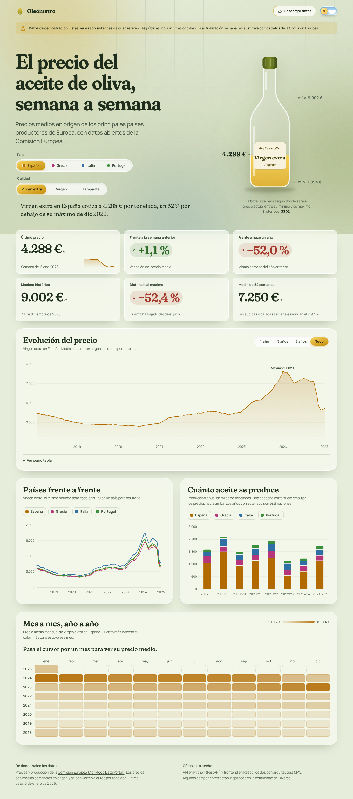
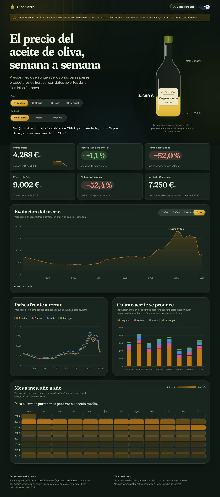
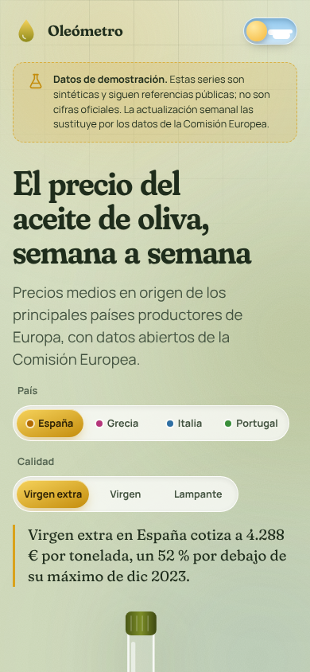

# Oleómetro

Dashboard de datos abiertos sobre el **precio del aceite de oliva en origen** (España, Italia, Grecia y Portugal), con producción anual y comparativas. Backend en **Python (FastAPI)** y frontend en **React**, los dos con arquitectura **MVC**. Se despliega **a coste 0** en GitHub Pages.



<table>
  <tr>
    <td></td>
    <td width="260"></td>
  </tr>
</table>

> **Sobre los datos.** El repositorio incluye un dataset de demostración **sintético** (sigue referencias públicas, pero no son cifras oficiales) para que todo funcione sin red. La web lo avisa con un banner. Al desplegar, GitHub Actions lo sustituye por los datos reales de la Comisión Europea (ver [Datos](#datos)).

## Qué incluye

- **La botella**: el elemento protagonista. Se llena según dónde está el precio actual entre su mínimo y su máximo históricos.
- Seis indicadores (último precio, variación semanal y anual, máximo, distancia al máximo, media de 52 semanas).
- Evolución del precio con selector de periodo y vista de tabla accesible.
- Comparativa entre países (se pueden ocultar series) y producción anual apilada.
- Mapa de calor año × mes del precio medio.
- Filtros por país y calidad (virgen extra, virgen, lampante) reflejados en la URL: `#it-lampante-5y` es un enlace compartible.
- Modo claro y oscuro, responsive, `prefers-reduced-motion` respetado, navegación por teclado y tablas equivalentes a los gráficos.

## Arquitectura (MVC en las dos mitades)

```
backend/app
├── main.py            ← índice: UNA sola ruta, la del controlador (include_router)
├── controllers/       ← C: endpoints HTTP finos. __init__.py es el registro
├── services/          ← lógica de negocio (agregados semanales, indicadores)
├── models/            ← M: entidades de dominio inmutables (sin framework)
├── repositories/      ← acceso a datos tras un Protocol (API europea | demo)
└── views/             ← V: esquemas Pydantic + presenters (lo que sale por la API)

frontend/src
├── main.jsx           ← índice: monta UN solo controlador
├── controllers/       ← C: estado, carga de datos, tema, selección (hooks)
├── models/            ← M: lógica pura y testeable (rangos, mensual, heatmap, ejes)
├── services/          ← fetch del JSON estático o de la API
└── views/             ← V: componentes de presentación (ui/ y sections/)
```

Flujo: `HTTP/fetch → controller → service → repository → model → presenter/view`.

### Escalar sin reescribir

| Quiero… | Qué toco |
|---|---|
| Otra fuente de datos (MAPA, Poolred, CSV…) | Una clase que cumpla `OliveOilRepository` y una línea en `repositories/__init__.py` |
| Un nuevo endpoint | `controllers/<nombre>_controller.py` con su `router` y añadirlo a `CONTROLLERS` |
| Otro país o producto | `OLIVE_COUNTRIES` (env) o `models/catalog.py` |
| Un nuevo panel | Selector en `models/dashboardModel.js`, componente en `views/sections/` y una línea en `DashboardView.jsx` |
| Una base de datos | Implementar un repositorio nuevo; servicios y controladores no cambian |

## Datos

Fuente: [Agri-food Data Portal](https://agridata.ec.europa.eu/extensions/DataPortal/olive-oil.html) de la Comisión Europea (API pública, sin clave). El cliente sigue su [especificación OpenAPI](https://api.tech.ec.europa.eu/agrifood/v3/api-docs/olive_oil):

- `GET /api/oliveOil/prices?marketingYears=2023/2024` (se pide campaña a campaña).
- `GET /api/oliveOil/production?granularity=annual`.

Decisiones defensivas (la especificación no fija estos formatos): precios y fechas se parsean en varios formatos, los precios se normalizan a €/tonelada (el portal publica €/100 kg), `EL` se trata como Grecia y los países se filtran en local. Todo está cubierto por tests contra una API simulada con el esquema oficial.

> **Pendiente de verificar con la API real.** El entorno donde se desarrolló no tenía salida a internet, así que el cliente se probó con respuestas simuladas, no contra el servicio vivo. La primera ejecución del workflow de despliegue lo confirmará: si falla, publica la demo y deja un aviso en el log.

## Ejecutarlo en local

```bash
# Backend
cd backend
python -m venv .venv && source .venv/bin/activate
pip install -r requirements-dev.txt
python -m pytest                     # 39 tests
uvicorn app.main:app --reload        # http://localhost:8000/docs

# Frontend (otra terminal)
cd frontend
npm install
npm run dev                          # lee public/data/dashboard.json
VITE_API_URL=http://localhost:8000 npm run dev   # …o la API
npm test && npm run build
```

Datos reales en estático: `cd backend && python -m scripts.export_static --source agridata`.
Con Docker: `docker compose up --build` (web en `:8080`, API en `:8000/docs`).

## Despliegue a coste 0

1. Sube el repo a GitHub y activa **Settings → Pages → Source: GitHub Actions**.
2. El workflow [`deploy.yml`](.github/workflows/deploy.yml) se ejecuta en cada push a `main` y **cada lunes**: descarga los datos, construye el frontend y publica en Pages. Sin servidor que se duerma, sin base de datos y sin secretos.
3. [`ci.yml`](.github/workflows/ci.yml) pasa los tests de backend y frontend en cada push y pull request.

## Diseño

- **Tipografía**: Fraunces (serif variable con eje *soft*) para titulares y cifras, y Manrope para el texto. Autoalojadas con `@fontsource`.
- **Paleta**: salvia, oliva y ámbar. Los colores de los países se validaron con el validador de la guía de dataviz (separación para daltonismo, contraste y banda de luminosidad) en claro y oscuro: España `#B26A00`, Italia `#2F6FA3`, Grecia `#B5367A`, Portugal `#3A8F3A` (en oscuro, variantes propias).
- **Técnicas**: CSS variables y temas, glassmorphism con `backdrop-filter`, bordes degradados que siguen al puntero (máscaras), `@property` + `conic-gradient`, `color-mix()`, container queries, CSS Grid, SVG con `clipPath` y animación de olas, grano con `feTurbulence`, Framer Motion y Recharts.
- **Componentes inspirados en [Uiverse](https://uiverse.io)** y reescritos para este proyecto: selector deslizante tipo *glider*, interruptor día/noche, botón con borde brillante y loader de gotas.

## Tests

- Backend (`pytest`): parsers, indicadores, cliente de la API europea con transporte simulado y contrato HTTP, incluida la comprobación de que el índice solo monta el router de controladores.
- Frontend (`vitest`): el modelo completo (rangos, medias mensuales, mapa de calor, ejes, selección y hash de la URL, formato).
