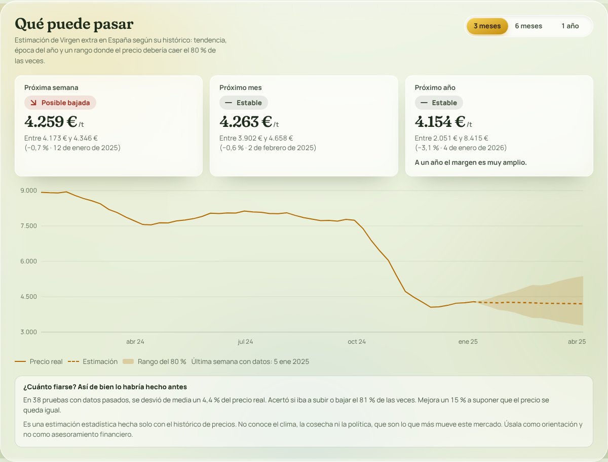
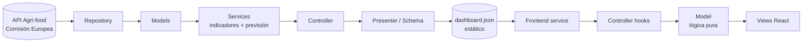

<div align="center">

# 🫒 Oleómetro

**Dashboard de datos abiertos del precio del aceite de oliva en origen, con previsión estadística y backtesting.**

España · Italia · Grecia · Portugal — datos reales de la Comisión Europea, actualizados cada semana.

[](https://javicastro03.github.io/Oleometro/)

[](https://github.com/JaviCastro03/Oleometro/actions/workflows/ci.yml)
[](https://github.com/JaviCastro03/Oleometro/actions/workflows/deploy.yml)


</div>


<table>
  <tr>
    <td></td>
    <td width="260"></td>
  </tr>
</table>

---

## Por qué existe

El aceite de oliva pasó de unos 3.000 €/t a más de 9.000 €/t en dos años y luego volvió a caer. Los datos son públicos, pero están en una API poco amigable. **Oleómetro** los convierte en algo que se entiende de un vistazo: dónde está el precio ahora, cómo se compara con su historia y con otros países, y qué podría pasar a continuación, **diciendo con honestidad cuánto fiarse de esa estimación**.

Es también un proyecto de portfolio: busca demostrar arquitectura limpia, testing, CI/CD, diseño cuidado y despliegue a coste cero.

## Qué incluye

- **La botella** 🍾: el elemento protagonista. Se llena según dónde está el precio actual entre su mínimo y su máximo históricos.
- **Seis indicadores**: último precio, variación semanal y anual, máximo histórico, distancia al máximo y media de 52 semanas.
- **Evolución del precio** con selector de periodo y tabla accesible equivalente.
- **Previsión a 1 semana, 1 mes y 1 año** con rango de confianza y backtesting (ver [más abajo](#previsión-con-honestidad)).
- **Comparativa entre países** (se pueden ocultar series) y **producción anual** apilada.
- **Mapa de calor** año × mes del precio medio, para ver la estacionalidad.
- **Filtros por país y calidad** (virgen extra, virgen, lampante) reflejados en la URL: `#it-lampante-5y` es un enlace compartible.
- **Modo claro y oscuro**, responsive, `prefers-reduced-motion` respetado, navegación por teclado y tablas equivalentes a cada gráfico.

## Previsión, con honestidad



El panel **«Qué puede pasar»** estima el precio a una semana, un mes y un año vista. El método es deliberadamente simple y explicable:

> Miro hacia dónde iba el precio últimamente (**tendencia**), le sumo lo que suele pasar en cada mes del año (**estacionalidad**), y la tendencia se va frenando poco a poco (**amortiguación**), porque ningún precio sube eternamente.

Técnicamente: suavizado exponencial de Holt con tendencia amortiguada sobre el logaritmo del precio, más factores estacionales mensuales, con parámetros elegidos por validación sobre el pasado.

Lo importante no es el modelo, sino cómo se presenta:

- **Rango, no un número único.** Cada previsión viene con una banda del 80 %, calculada a partir de los errores reales que el método cometió en el pasado.
- **Backtesting visible.** El panel muestra cuántas veces habría acertado si el precio subía o bajaba, el error medio, y **si mejora a la apuesta ingenua de que el precio se queda igual**. Si no mejora, lo dice.
- **Se calla cuando no sabe.** Con menos de 60 semanas seguidas o sin datos recientes no hay previsión, y la web lo explica en lugar de inventarla.
- **Aviso claro.** El mercado depende de clima, cosecha y política, que un histórico de precios no ve. Es una orientación, no asesoramiento financiero.

## Arquitectura: MVC en las dos mitades

El proyecto aplica **MVC tanto en el backend como en el frontend**, y los puntos de entrada solo conectan con el controlador.

```
backend/app
├── main.py            ← índice: UNA sola ruta, la del controlador (include_router)
├── controllers/       ← C: endpoints HTTP finos. __init__.py es el registro
├── services/          ← lógica de negocio (agregados semanales, indicadores, previsión)
├── models/            ← M: entidades de dominio inmutables (sin framework)
├── repositories/      ← acceso a datos tras un Protocol (API europea | demo)
└── views/             ← V: esquemas Pydantic + presenters (lo que sale por la API)

frontend/src
├── main.jsx           ← índice: monta UN solo controlador
├── controllers/       ← C: estado, carga de datos, tema, selección (hooks)
├── models/            ← M: lógica pura y testeable (rangos, mensual, heatmap, ejes, previsión)
├── services/          ← fetch del JSON estático o de la API
└── views/             ← V: componentes de presentación (ui/ y sections/)
```



### Escalar sin reescribir

| Quiero… | Qué toco |
|---|---|
| Otra fuente de datos (MAPA, Poolred, CSV…) | Una clase que cumpla `OliveOilRepository` y una línea en `repositories/__init__.py` |
| Un nuevo endpoint | `controllers/<nombre>_controller.py` con su `router` y añadirlo a `CONTROLLERS` |
| Otro país o producto | `OLIVE_COUNTRIES` (env) o `models/catalog.py` |
| Otro método de previsión | Sustituir `services/forecast.py`; el contrato (`Forecast`) no cambia |
| Un nuevo panel | Selector en `models/dashboardModel.js`, componente en `views/sections/` y una línea en `DashboardView.jsx` |
| Una base de datos | Implementar un repositorio nuevo; servicios y controladores no cambian |

## Decisiones técnicas

| Decisión | Por qué |
|---|---|
| **Sitio estático + exportación semanal** | Un script de Python genera `dashboard.json` y GitHub Pages lo sirve. Sin servidor que se duerma, sin base de datos, sin secretos: **coste 0** y cero mantenimiento. La API FastAPI sigue disponible para quien la quiera desplegar. |
| **Patrón repositorio tras un `Protocol`** | Servicios y controladores no saben de dónde vienen los datos. Hay un repositorio real (API europea) y uno sintético (demo y tests). |
| **Parseo defensivo** | La especificación de la API no fija formatos: precios y fechas se parsean en varios formatos, se normalizan a €/tonelada (el portal publica €/100 kg), `EL` se trata como Grecia y los países se filtran en local. |
| **Huecos en los datos** | Los de menos de 4 semanas se rellenan; si son mayores se corta la serie. Sin datos recientes, no se prevé. |
| **Previsión explicable, no un modelo opaco** | Se puede defender cada paso y, sobre todo, medir su acierto real (backtesting sin fuga de datos). |
| **Colores validados para daltonismo** | La paleta categórica de países se comprobó (separación, contraste y luminosidad) en claro y oscuro. |
| **Fallback elegante en el despliegue** | Si la API europea falla en el robot semanal, se publica el dataset de demostración con un aviso visible, nunca una web rota. |

## Datos

Fuente: [Agri-food Data Portal](https://agridata.ec.europa.eu/extensions/DataPortal/olive-oil.html) de la Comisión Europea (API pública, sin clave). El cliente sigue su [especificación OpenAPI](https://api.tech.ec.europa.eu/agrifood/v3/api-docs/olive_oil):

- `GET /api/oliveOil/prices?marketingYears=2023/2024` (se pide campaña a campaña).
- `GET /api/oliveOil/production?granularity=annual`.

Algunas series (por ejemplo Portugal) tienen pocos datos o con huecos en la fuente; en esos casos la web lo refleja en lugar de rellenar.

> El repositorio incluye también un **dataset sintético de demostración** que permite ejecutar todo sin red. Cuando se usa, la web muestra un banner amarillo «Datos de demostración».

## Stack

| Capa | Tecnología |
|---|---|
| Backend | Python 3.12, FastAPI, Pydantic, httpx |
| Frontend | React 19, Vite, Recharts, Framer Motion, lucide-react |
| Estilos | CSS Modules, variables CSS, temas claro/oscuro |
| Tipografía | Fraunces (variable, eje *soft*) + Manrope, autoalojadas con `@fontsource` |
| Tests | pytest (50) · Vitest (15) |
| CI/CD | GitHub Actions + GitHub Pages |
| Opcional | Docker y docker-compose |

## Diseño

- **Técnicas**: CSS variables y temas, glassmorphism con `backdrop-filter`, bordes degradados que siguen al puntero (máscaras), `@property` + `conic-gradient`, `color-mix()`, container queries, CSS Grid, SVG con `clipPath` y olas animadas, grano con `feTurbulence`.
- **Componentes inspirados en el estilo de [Uiverse](https://uiverse.io)** y escritos desde cero para este proyecto: selector deslizante tipo *glider*, interruptor día/noche, botón con borde brillante y loader de gotas.
- **Accesibilidad**: contraste, foco visible, `aria-*`, tablas alternativas a los gráficos y respeto a `prefers-reduced-motion`.

## Ejecutarlo en local

Requisitos: Python 3.12+ y Node 22+ (con conda: `conda create -n oleometro python=3.12 nodejs=22 -c conda-forge`).

```bash
# Backend
cd backend
python -m pip install -r requirements-dev.txt
python -m pytest                     # 50 tests
uvicorn app.main:app --reload        # http://localhost:8000/docs

# Frontend (otra terminal)
cd frontend
npm install
npm run dev                          # lee public/data/dashboard.json → http://localhost:5173
VITE_API_URL=http://localhost:8000 npm run dev   # …o la API en vivo
npm test && npm run build
```

Para generar el JSON con datos reales: `cd backend && python -m scripts.export_static --source agridata`.
Con Docker (opcional): `docker compose up --build` (web en `:8080`, API en `:8000/docs`).

## Despliegue a coste 0

1. Sube el repo a GitHub y activa **Settings → Pages → Source: GitHub Actions**.
2. [`deploy.yml`](.github/workflows/deploy.yml) se ejecuta en cada push a `main` y **cada lunes**: descarga los datos reales, construye el frontend con Vite y publica en Pages.
3. [`ci.yml`](.github/workflows/ci.yml) pasa los tests de backend y frontend en cada push y pull request.

## Tests

- **Backend (`pytest`, 50 tests)**: parsers, indicadores, previsión (tendencia, estacionalidad, huecos, series abandonadas, backtesting), cliente de la API europea con transporte simulado y contrato HTTP, incluida la comprobación de que el índice solo monta el router de controladores.
- **Frontend (`vitest`, 15 tests)**: el modelo completo (rangos, medias mensuales, mapa de calor, ejes, selección y hash de la URL, formato y previsión).

## Hoja de ruta

- [ ] Descarga de la serie en CSV
- [ ] Calculadora de coste de compra a precio de origen
- [ ] Más países productores (Túnez, Turquía, Marruecos)
- [ ] Versión en inglés
- [ ] Cruce con datos de clima y producción
- [ ] Repositorio con base de datos para guardar un histórico propio

## Licencia

[MIT](LICENSE) · Hecho por [@JaviCastro03](https://github.com/JaviCastro03)
